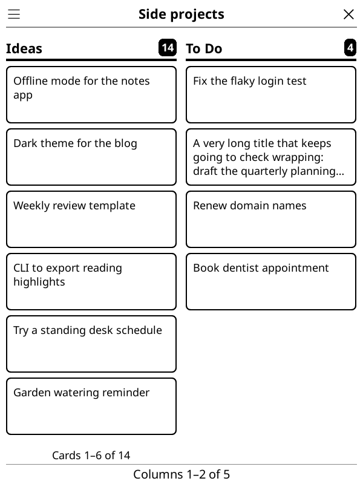
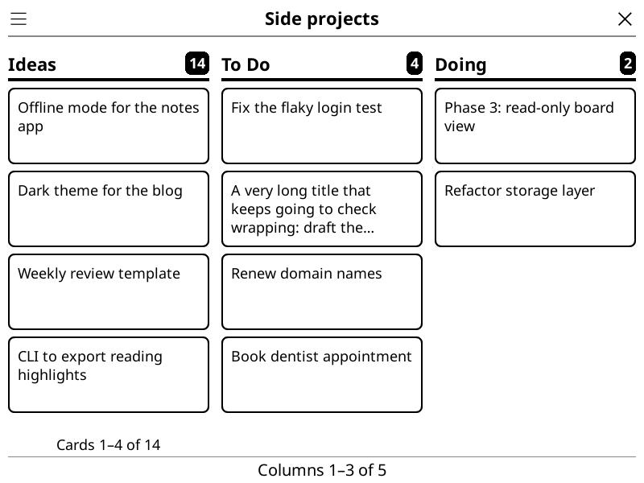
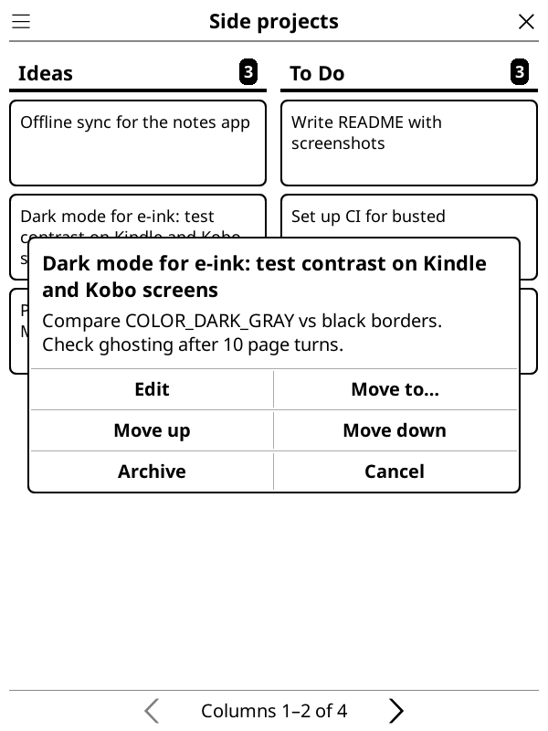
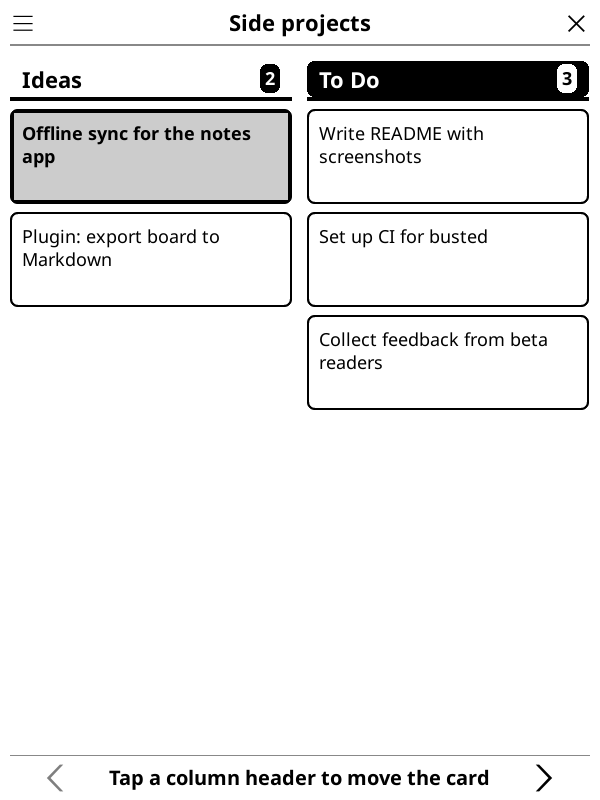
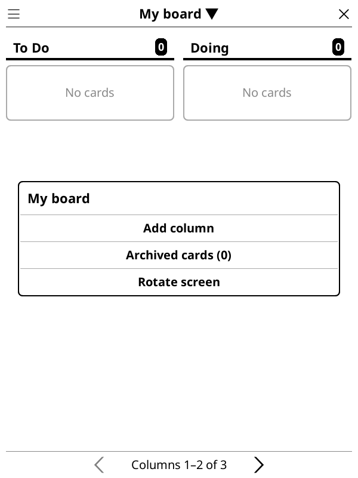

# Kanban board for KOReader

Kanban is a KOReader plugin for tracking projects, ideas, and general tasks with
boards, columns, and cards. Cards are not linked to books.

## Features

- Organize cards into ordered columns and move or reorder columns.
- Add and edit cards with a title and optional notes. Card actions include moving
  a card to another column, moving it up or down within its column, and archiving
  it.
- Hold a card to start a quick move, then tap a different column header to move
  it there. Tap elsewhere to cancel.
- Restore archived cards to a selected column. Deleting a column archives its
  cards rather than deleting them.
- Create, switch between, rename, and delete multiple boards. Tap the board name
  (marked ▼) in the title bar to open the Boards dialog.
- Open the board from **Tools → Kanban board → Open board** in both the File
  Manager and Reader, or bind any of these actions in Gesture manager:
  - **Open Kanban board**
  - **Add Kanban card** (opens the card editor for the first column of the
    currently selected board)
  - **Kanban: Today**
- **Today** (board menu ☰, or the gesture above) lists the cards in every
  board's in-progress column, grouped by board. The in-progress column is the
  second-to-last column unless you pick another in its column dialog.
- **Show board on sleep screen** (Tools → Kanban board) shows the current board
  as the sleep screen. Turning it off restores your previous sleep screen
  settings.
- Board layout adapts when the screen rotates. On devices without an
  accelerometer, **Rotate screen** in the board menu (☰) switches between
  portrait and landscape. Swipe to navigate column pages
  and card pages; the page-turn keys move between column pages.

## Screenshots

| Board in portrait | Board in landscape |
| --- | --- |
|  |  |

| Card actions | Quick-move a card |
| --- | --- |
|  |  |



## Installation

From the repository root, run `./package.sh` to build `kanban.koplugin.zip`.
The zip contains the `kanban.koplugin/` folder. Unzip it into KOReader's
`plugins/` folder, or copy the `kanban.koplugin/` folder there, then restart
KOReader.

## Data file

Board data is stored in `kanban.lua` in KOReader's settings directory, returned
by `DataStorage:getSettingsDir()` (for example, `koreader/settings/kanban.lua`).
If the data file is corrupt, the plugin keeps a backup as `kanban.lua.bak`.

## Known issues

- Keyboard-only navigation is not supported. The board handles Back and the
  page-turn keys only.

## Development

Run the test suite from the repository root with:

```sh
busted
```
